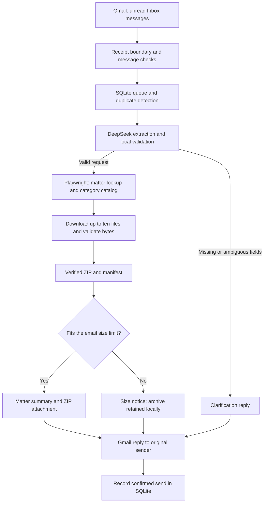

# Senpilot document agent

An email driven agent that retrieves regulatory documents from the [Nova Scotia public matters database](https://uarb.novascotia.ca/fmi/webd/UARB15), packages up to ten files, and replies with a ZIP attachment and matter summary.

Send a request such as:

> Can you give me Other Documents files from M12205?

Supported document types are **Exhibits**, **Key Documents**, **Other Documents**, **Transcripts**, and **Recordings**. The reply includes the matter title, type, category, status, outcome, source date labels, all five category counts, and the actual download count.

**Known limitation:** the application limits the complete encoded email to 20,000,000 bytes. An oversized ZIP receives a notice without an attachment; the archive stays local. This is partial coverage of the assignment's attachment requirement. There is no hosted download link or split archive delivery.

## Architecture

The agent is a Python application with a sequential worker, SQLite job queue, Gmail API adapter, DeepSeek request extraction, and Playwright browser automation. A service wrapper adds supervision and background operation.



The AI model extracts the matter number and document type. Python code controls the website, file paths, selection order, recipient, archive contents, and delivery. The browser workflow uses fixed selectors and explicit checks rather than model selected actions.

| Component | Source | Responsibility |
| --- | --- | --- |
| Gmail adapter | [gmail.py](senpilot/gmail.py) | OAuth authorization, receipt filtering, reading messages, and sending MIME replies. |
| Intake and queue | [email.py](senpilot/email.py), [messages.py](senpilot/messages.py), [queue.py](senpilot/queue.py) | Message checks, polling, persistent jobs, duplicate detection, and exclusive worker locks. |
| Request extraction | [requests.py](senpilot/requests.py) | DeepSeek JSON output, schema checks, and comparison against the explicit values in the request. |
| Job orchestration | [worker.py](senpilot/worker.py) | Connect extraction, retrieval, packaging, reply preparation, and confirmed sending. |
| Website navigation | [browser.py](senpilot/browser.py), [catalog.py](senpilot/catalog.py) | Matter lookup, metadata, category counts, and traversal of virtual document rows. |
| Retrieval and transfers | [retrieval.py](senpilot/retrieval.py), [downloads.py](senpilot/downloads.py), [transfer.py](senpilot/transfer.py), [access.py](senpilot/access.py) | File selection, browser downloads, checkpoints, timeouts, and access block detection. |
| File and ZIP validation | [files.py](senpilot/files.py), [packaging.py](senpilot/packaging.py) | Format checks, safe paths, hashes, manifest creation, and archive verification. |
| Email delivery | [delivery.py](senpilot/delivery.py), [messages.py](senpilot/messages.py) | Attachment verification, encoded message size checks, and deterministic reply text. |
| Service runtime | [service.py](senpilot/service.py), [runtime.py](senpilot/runtime.py) | Configuration, key loading, local preflight, supervision, rotating logs, and heartbeat. |

## How a request is handled

1. **Receive and queue.** Poll unread Inbox messages, normally every 60 seconds. Gmail message IDs prevent repeated handling in the same state directory. Unrestricted intake persists its initial receipt boundary so old unread mail is excluded after restarts.
2. **Check the message.** Reject self messages, automatic replies, delivery reports, mailing lists, subscription mail, malformed senders, and requests over 1 MB. In unrestricted mode, messages without document request cues are ignored before extraction.
3. **Extract and validate.** Send the subject and current text body to DeepSeek, using JSON mode with thinking disabled. Require one explicit matter number and one supported category. Missing or ambiguous fields produce clarification; malformed or failed provider responses record a processing failure. There is no silent fallback to another extractor.
4. **Retrieve documents.** Open the public site in headless Chrome, search for the matter, verify the returned matter number, read its metadata and all category counts, and enumerate the selected category beyond the first viewport. Choose the newest eligible entries with deterministic ties, stopping after ten successful downloads.
5. **Verify and package.** Download through Playwright events and `save_as` in the same browser session. Validate each completed file, record its size and SHA256, and create a ZIP containing only accepted files plus `manifest.json`. Read the archive back to check entries, hashes, sizes, and CRCs.
6. **Reply and journal.** Prepare the matter summary, attach the verified ZIP when it fits, and send to the original From address. Body instructions and Reply-To headers cannot redirect delivery. The watcher sends each completed reply before starting the next job.

The queue tracks `pending ? processing ? prepared ? sending ? sent`, with separate `ignored`, `failed`, and `send_uncertain` outcomes. A lost send confirmation is never retried automatically because delivery may already have happened.

## Repository structure

```text
senpilot/                 Application modules and command entry points
tests/                    Unit, pipeline, recovery, and local browser tests
deploy/
    agent.example.json    Starting configuration for a local installation
    windows/              Windows Task Scheduler registration script
    Dockerfile            Alternative Linux image definition
    compose.yaml          Container configuration and persistent mounts
examples/                 Sample request emails for local previews
scripts/                  Transport diagnostics and Compose schema checker
docs/                     Setup, deployment, design decisions, and test evidence
Slide/                    Collaboration reference material
WORKFLOW.md               Working decisions and implementation milestones
requirements*.txt         Pinned runtime and optional development dependencies
artifacts/                Generated state, credentials, downloads, and logs
```

`artifacts/`, local environments, `deploy/agent.json`, tokens, keys, and downloaded files are excluded from Git. They are created during setup and execution.

## Setup on Windows

Use **Python 3.12**, installed **Google Chrome**, a Gmail account for the agent, a Google Cloud project with Gmail API access, and a DeepSeek API key. Requesters can use any email provider.

Run commands from the repository root in PowerShell. These steps configure a fresh installation.

### 1. Install dependencies

```powershell
py -3.12 -m venv .venv
$senpilotPython = '.\.venv\Scripts\python.exe'
& $senpilotPython -m pip install -r requirements-email.txt
```

This installs the retrieval and email dependencies. The application launches installed Chrome through Playwright's `chrome` channel.

**Existing configured checkout:** its Windows task uses Python 3.12.16 in a separate environment. Select that interpreter and use the operating commands below without replacing its configuration or credentials:

```powershell
$senpilotPython = '.\artifacts\runtime\venv\Scripts\python.exe'
```

See the [runtime installation guide](docs/runtime-upgrade.md) if Python 3.12 is not installed.

### 2. Create the local configuration

Choose the agent mailbox. For a fresh installation, the following creates the configuration from the tracked example, sets the address, and captures a receipt boundary before the first test email. It refuses to overwrite an existing configuration.

```powershell
$senpilotAgent = 'your.agent@gmail.com'
if (Test-Path '.\deploy\agent.json') {
    throw 'Configuration already exists. Review and reuse it instead of overwriting it.'
}
$senpilotConfig = Get-Content '.\deploy\agent.example.json' -Raw | ConvertFrom-Json
$senpilotConfig.agent_address = $senpilotAgent
$senpilotConfig | Add-Member -NotePropertyName received_after -NotePropertyValue ([DateTimeOffset]::UtcNow.ToUnixTimeSeconds() - 1)
$senpilotConfig | ConvertTo-Json | Set-Content '.\deploy\agent.json' -Encoding UTF8
```

Replace `your.agent@gmail.com` with the account you will authorize. The example supplies these settings:

| Setting | Default and meaning |
| --- | --- |
| `agent_address` | Must match the Gmail account used during OAuth authorization. |
| `accept_any_sender` / `allowed_senders` | `true` and `[]` accept any sender. For restricted intake, use `false` and a nonempty address list. |
| `state` | `../artifacts/email/live` stores the queue and generated job files. |
| `token` | `../artifacts/oauth/token.json` stores the authorized Gmail token. |
| `deepseek_key_file` | `../artifacts/deploy/deepseek.key` stores the local API key. |
| `model` | `deepseek-flash`. |
| `send` | `true` enables sending replies. Set `false` to prepare local replies for review. |
| `poll_seconds` / `job_interval` | `60` seconds between polls and `5` seconds between queued jobs. |
| `restart_limit` / `restart_delay` | Five supervisor retries, initially five seconds apart with increasing delays. |
| `received_after` | Optional receipt boundary in Unix seconds. The setup command records the current time; unrestricted intake otherwise records its first launch time. |

Paths in the JSON are relative to `deploy/agent.json`. The receipt boundary persists in SQLite when used. Change it deliberately when including an earlier test message; choosing an old timestamp can expose historical mail to processing. Restart the worker after configuration changes.

### 3. Authorize Gmail

Follow Google's [Gmail Python setup guide](https://developers.google.com/workspace/gmail/api/quickstart/python) to:

1. Create a Google Cloud project and enable the Gmail API.
2. Configure the OAuth consent screen. For a personal Gmail account, use an external audience and add the **agent account** under test users while the app is in testing.
3. Create an OAuth client with application type **Desktop app**.
4. Save the downloaded client JSON as `artifacts/oauth/credentials.json`.

Create the local directory if needed, then authorize the chosen mailbox:

```powershell
New-Item -ItemType Directory -Force '.\artifacts\oauth' | Out-Null
& $senpilotPython -m senpilot.gmail --agent $senpilotAgent
```

Complete Google's consent flow in the browser. The helper checks the selected account and saves `artifacts/oauth/token.json`.

The agent requests `gmail.readonly` and `gmail.send`. It cannot move messages, mark them read, create filters, or upload archives to Drive. Requesters do not need OAuth authorization or registration as test users. Reauthorize the agent when its grant expires or is revoked.

### 4. Store the DeepSeek key

Create a key through the [DeepSeek API platform](https://api-docs.deepseek.com/), then run:

```powershell
& $senpilotPython -m senpilot.service --config deploy/agent.json --store-key
```

The command uses `DEEPSEEK_API_KEY` if it is already set; otherwise it prompts privately. It writes the configured key file and refuses to overwrite an existing file. The service loads that file for background execution. Keep the key and Gmail credentials outside tracked source.

The client calls `https://api.deepseek.com/chat/completions`. Its [JSON output](https://api-docs.deepseek.com/guides/json_mode/) is validated locally before any retrieval begins.

### 5. Check setup and run the service

```powershell
& $senpilotPython -m senpilot.service --config deploy/agent.json --check
& $senpilotPython -m senpilot.service --config deploy/agent.json
```

The preflight checks local configuration, token structure and scopes, key availability, state locks, and a blank Chrome launch. Provider access is exercised when the worker starts handling mail.

With `send: true`, the service sends replies automatically. Keep this terminal open for foreground operation; Ctrl+C stops it and preserves the queue.

From another mailbox, send the example request to the agent. Leave it **unread in the Inbox** until polled. Processing time includes website navigation and downloads.

### 6. Check Spam routing

The worker reads the Inbox, so a request placed in Spam is not received by the application. Move an existing request with **Not spam**, then leave it unread.

The existing demonstration mailbox has a Gmail filter for future requests. To reproduce it, open Gmail's search options, set **To** to the agent address, leave **From** blank, and set **Includes the words** to:

```text
{Exhibits "Key Documents" "Other Documents" Transcripts Recordings}
```

Choose **Create filter**, select **Never send it to Spam**, and save. Anyone using these terms can match the rule. It applies to matching future mail and does not move existing conversations out of Spam.

## Run without an open terminal

Stop the foreground worker before registering the Windows task. Only one worker should process the mailbox using its complete state directory.

```powershell
.\deploy\windows\Register-AgentTask.ps1 -Config .\deploy\agent.json -PythonPath $senpilotPython -WhatIf
.\deploy\windows\Register-AgentTask.ps1 -Config .\deploy\agent.json -PythonPath $senpilotPython -Start
```

The first command previews registration; the second registers and starts task **SenpilotAgent**. The script runs preflight and refuses to replace an existing task. An existing matching task can be updated with `-Update` after stopping it; see [deployment](docs/deployment.md).

The task runs through `pythonw.exe` at the current user's logon. The computer must remain awake, online, and signed in. An actual Windows logoff or reboot has not been tested.

```powershell
Get-ScheduledTask -TaskName SenpilotAgent
Stop-ScheduledTask -TaskName SenpilotAgent
Start-ScheduledTask -TaskName SenpilotAgent
```

A Linux Docker and Compose alternative is provided in `deploy/`. Its schema was validated; the image has not been built or run in this workspace. See the [deployment guide](docs/deployment.md) for mounts, credentials, and commands.

## Local commands and output

Retrieval and packaging can run independently of Gmail and DeepSeek:

```powershell
& $senpilotPython -m senpilot M12205 'Other Documents'
& $senpilotPython -m senpilot M12205 'Key Documents' --limit 3
& $senpilotPython -m senpilot M12205 Transcripts --limit 0
```

`--limit` accepts 0 to 10 and counts successful files; 0 collects metadata and the category catalog without downloading files. `--output PATH` selects a fresh destination. Existing output directories are refused.

The default retrieval directory is `artifacts/retrieval/<request>/`. Email jobs place the same retrieval outputs under `artifacts/email/live/jobs/<job>/a<attempt>/retrieval/`.

| Output | Contents |
| --- | --- |
| `report.json` | Request, matter metadata, source date labels, all category counts, catalog, completed files, skipped entries, failures, and warnings. Checkpointed after each attempted file. |
| `files/` | Completed downloads with safe names and identity prefixes. Original names remain in the report and manifest. |
| `incomplete/` | Temporary browser and validation files, excluded from the completed file list. |
| `package/documents.zip` | Up to ten completed source files plus `manifest.json`. Created when there are files to package. |
| `package/package.json` | Package status, manifest, archive size, SHA256, and verification result. |
| `reply.eml` | Prepared email in each email job's attempt directory, available before or after sending. |

To package a saved report without downloading again:

```powershell
& $senpilotPython -m senpilot.package artifacts/retrieval/your-run/report.json
```

Replace the example path with an existing report. The default destination is a new `package/` directory beside it; use `--output` for another fresh destination.

For an email preview without Gmail or AI calls, use a matching saved M12205 Other Documents report:

```powershell
& $senpilotPython -m senpilot.email --eml examples/request.eml --agent andi.xie241@gmail.com --accept-any-sender --extractor exact --saved-report artifacts/retrieval/your-run/report.json --state artifacts/email/preview
```

This writes a local reply without sending. `exact` is an explicit deterministic testing mode. Saved downloads are ignored artifacts and must be generated on a fresh checkout.

## Operating and troubleshooting

```powershell
& $senpilotPython -m senpilot.service --config deploy/agent.json --health
Get-Content artifacts/email/live/service/heartbeat.json
Get-Content artifacts/email/live/service/worker.log -Tail 20
```

The heartbeat updates about every five seconds. Health checks local liveness and recorded queue problems; it does not prove provider availability or recipient delivery. Logs rotate at 5 MB with three backups and redact the configured DeepSeek key.

| Symptom | Check or action |
| --- | --- |
| No queued request | Confirm the agent mailbox, unread Inbox status, Spam placement, sender policy, and `received_after` boundary. |
| Worker lock error | Stop the other worker using that state directory. Do not delete lock files to bypass it. |
| `failed` job | Inspect the error and configuration. Explicit retry is available through the email CLI; see [email setup](docs/email-setup.md). |
| `send_uncertain` | Inspect Sent mail before reconciliation. The service will not automatically repeat a potentially delivered email. |
| Site pause | Resolve the recorded access block before using `--resume-site`. The agent does not bypass challenges or HTTP 403/429 responses. |
| ZIP omitted | Check the size notice or empty result. Oversized archives remain local. |

Use `python -m senpilot.email --status --state artifacts/email/live` only while the worker is stopped, since that command also requires the queue lock. Preserve the whole state directory when moving the installation; separate copies do not share duplicate detection.

## Behavior and limitations

- Selection uses newest source dates with deterministic ties; missing dates sort last. Public entries are eligible. Confidential entries are skipped. Published Recording rows with blank security labels are attempted through the normal guest UI.
- Each failed file is retried once; another eligible entry can replace it to reach ten successes. Transfers stop after 30 seconds without byte progress or 15 minutes total. Recognized access blocks stop retrieval and persist a queue pause.
- PDFs, MP3 headers, WAV headers, and ZIP containers receive format checks. Other files receive a nonempty content check. Every completed file receives a size and SHA256. Audio is not fully decoded; source header inconsistencies remain warnings with original bytes preserved.
- Packaging rejects unsafe paths, changed source files, and duplicate archive paths. Compression and verification stream file data and support ZIP64.
- Category counts may overlap. Their sum is labelled category entries rather than a unique physical file count. Date labels are preserved; a final filing date is not invented from Decision Date.
- Empty categories return an explanation without an empty ZIP. Partial retrievals retain their successful files and explicit failure information.
- The tested WAV samples were approximately 411 MB and 472 MB; one produced a 392 MB ZIP. Oversized requests therefore remain a disclosed delivery limitation.
- Windows availability depends on this machine and user session. Queue history and downloaded artifacts are retained; there is no automatic cleanup policy.

## Validation and further reading

The latest recorded suite ran **91 tests: 90 passed and one Windows symlink test was skipped**. Tests cover request validation, MIME delivery, queue recovery, intake boundaries, per job sending, catalog traversal, packaging, and real Chrome downloads against local test servers.

```powershell
& $senpilotPython -m unittest discover -s tests -v
```

Live Gmail, DeepSeek extraction, browser retrieval, ZIP replies, Windows background processing, and recipient receipt were exercised. All five source category layouts were tested for retrieval; live email delivery has been exercised for Other Documents. Docker execution and an actual Windows reboot remain unverified.

| Guide | Purpose |
| --- | --- |
| [Demo and handoff](docs/demo.md) | Reproducible demonstration and design discussion. |
| [Requirements review](docs/requirements-review.md) | Assignment coverage, assumptions, and the attachment limitation. |
| [Email setup](docs/email-setup.md) | Detailed OAuth, extraction, previews, sender policies, and queue recovery. |
| [Deployment](docs/deployment.md) | Windows task, Linux container, logs, health, and recovery. |
| [Deployment validation](docs/deployment-validation.md) | Live evidence, intake repair, Spam recovery, and receipt confirmation. |
| [Retrieval validation](docs/retrieval-validation.md) / [packaging validation](docs/packaging-validation.md) | Source cases and archive checks. |
| [Transport probe](docs/transport-probe.md) | Optional browser versus HTTP diagnostics; production retrieval uses browser downloads. |
| [Working decisions](WORKFLOW.md) | Collaboration approach, milestones, and recorded choices. |
